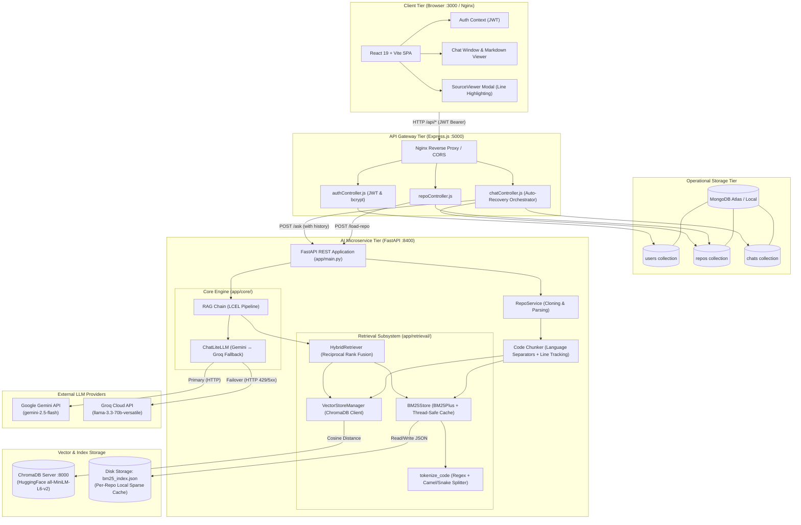
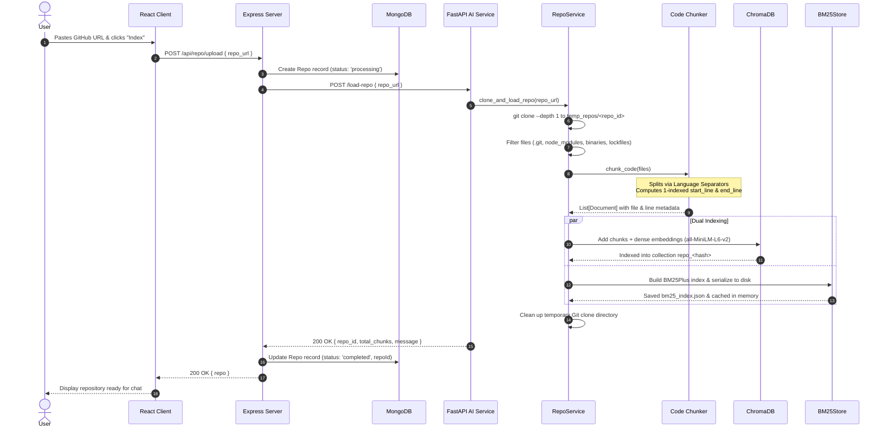
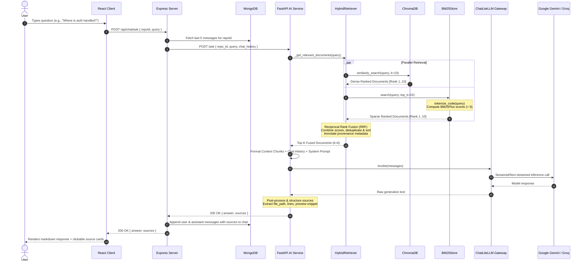
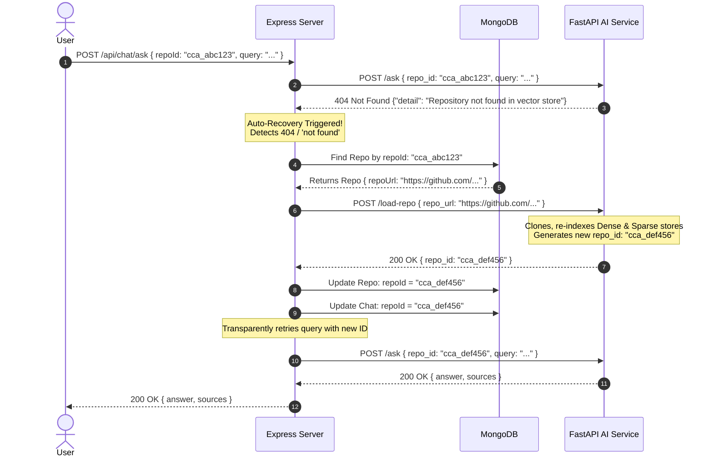
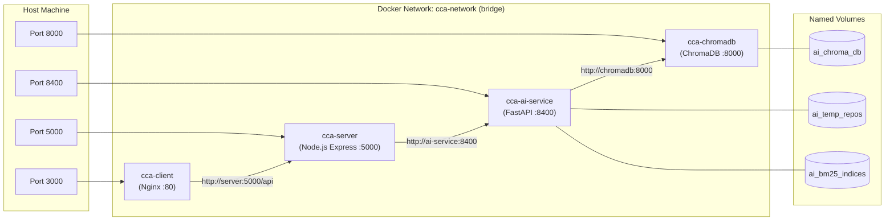

# 🏛️ System Architecture — Codebase Chat Assistant

This document provides a comprehensive technical reference for the architecture, component design, data pipelines, retrieval strategies, database schemas, and deployment topologies of the **Codebase Chat Assistant**.

---

## 📑 Table of Contents

1. [Executive Summary](#1-executive-summary)
2. [High-Level System Architecture](#2-high-level-system-architecture)
3. [Tier & Component Breakdown](#3-tier--component-breakdown)
   - [3.1 Frontend Client (React + Vite)](#31-frontend-client-react--vite)
   - [3.2 Backend API Gateway (Express.js)](#32-backend-api-gateway-expressjs)
   - [3.3 AI Microservice (FastAPI + LangChain)](#33-ai-microservice-fastapi--langchain)
   - [3.4 Storage & Search Engines](#34-storage--search-engines)
4. [End-to-End Data Flows & Sequence Diagrams](#4-end-to-end-data-flows--sequence-diagrams)
   - [Flow 1: Repository Ingestion & Dual Indexing](#flow-1-repository-ingestion--dual-indexing)
   - [Flow 2: Conversational Hybrid RAG & Answer Generation](#flow-2-conversational-hybrid-rag--answer-generation)
   - [Flow 3: Resilient LLM Multi-Provider Failover](#flow-3-resilient-llm-multi-provider-failover)
   - [Flow 4: Self-Healing Vector DB Auto-Recovery](#flow-4-self-healing-vector-db-auto-recovery)
5. [Hybrid Search Deep Dive (Dense + Sparse + RRF)](#5-hybrid-search-deep-dive)
   - [5.1 Why Pure Dense or Pure Sparse Fails for Code](#51-why-pure-dense-or-pure-sparse-fails-for-code)
   - [5.2 Code-Aware Tokenization](#52-code-aware-tokenization)
   - [5.3 BM25Plus Algorithm & Non-Negative IDF](#53-bm25plus-algorithm--non-negative-idf)
   - [5.4 Reciprocal Rank Fusion (RRF) Mathematics](#54-reciprocal-rank-fusion-rrf-mathematics)
   - [5.5 Provenance Metadata & Score Attribution](#55-provenance-metadata--score-attribution)
6. [Multi-Provider LLM Gateway (LiteLLM)](#6-multi-provider-llm-gateway-litellm)
7. [Database Schemas & Data Structures](#7-database-schemas--data-structures)
8. [Concurrency, Thread-Safety & Caching Model](#8-concurrency-thread-safety--caching-model)
9. [Deployment & Container Infrastructure](#9-deployment--container-infrastructure)

---

## 1. Executive Summary

**Codebase Chat Assistant** is a production-grade developer tool that enables conversational question answering over arbitrary public Git repositories. 

Unlike generic document chat assistants, code retrieval presents unique challenges:
- Queries often feature **exact symbol names** (e.g. `authMiddleware`, `validateJWT`), file paths (e.g. `server/routes/chatRoutes.js`), and HTTP routes (`POST /api/chat/ask`), which standard dense semantic vector embeddings frequently miss.
- Conversely, queries often feature **conceptual questions** (e.g. *"How is token expiration handled?"* or *"Explain the repository ingestion lifecycle"*), where keyword-only search fails.

To bridge this gap, the platform implements a **Hybrid Search Pipeline** that unifies:
1. **Dense Vector Search**: Powered by HuggingFace `all-MiniLM-L6-v2` (384-dimensional dense vectors) and ChromaDB.
2. **Sparse Keyword Search**: Powered by a custom code-aware tokenizer and the `BM25Plus` ranking algorithm.
3. **Reciprocal Rank Fusion (RRF)**: A principled rank-aggregation algorithm combining dense and sparse results with configurable weights.
4. **Multi-Provider LLM Gateway**: Powered by LiteLLM with Google Gemini as the primary provider and Groq (LLaMA 3.3 70B) as an automated zero-downtime failover.

---

## 2. High-Level System Architecture

The following diagram depicts the overarching multi-tier microservice architecture:



---

## 3. Tier & Component Breakdown

### 3.1 Frontend Client (React + Vite)
- **Directory**: `client/`
- **Stack**: React 19, Vite, Tailwind CSS v4, Framer Motion, Axios, `react-markdown`.
- **Key Modules**:
  - `src/context/AuthContext.jsx`: Persists JWT token in `localStorage`, injects Bearer token into outbound Axios requests, and maintains user session state.
  - `src/components/Sidebar.jsx`: Displays loaded repositories, upload form for Git URLs, repo deletion, and active repository selector.
  - `src/components/ChatWindow.jsx`: Renders conversational thread with markdown syntax highlighting, code blocks with one-click copy, and interactive source badges.
  - `src/components/SourceViewer.jsx`: Slide-out inspector that displays full file contents with highlighted line ranges matching chunk citations.
  - `nginx.conf`: Production container server serving static SPA bundles and reverse-proxying `/api/*` to the Express backend.

### 3.2 Backend API Gateway (Express.js)
- **Directory**: `server/`
- **Stack**: Node.js 20, Express 5, Mongoose, JWT (`jsonwebtoken`), `bcryptjs`, Axios.
- **Key Responsibilities**:
  - **User & Auth Management**: User registration, password hashing, and token issuance.
  - **Repository Metadata**: Tracking user repositories, status lifecycle (`processing` $\rightarrow$ `completed` | `failed`), and repository identifier mapping.
  - **Conversational Memory**: Storing multi-turn message history per user and repository in MongoDB.
  - **Auto-Recovery Orchestrator**: In the event of a missing vector index in the AI service (e.g. following container rebuilds or disk resets), `chatController.js` catches the 404 exception, re-triggers `/load-repo`, updates the database record with the new vector ID, and retries the user's query seamlessly.

### 3.3 AI Microservice (FastAPI + LangChain)
- **Directory**: `ai-service/`
- **Stack**: Python 3.11, FastAPI 0.115+, Uvicorn, LangChain 0.3+, LiteLLM 1.70+, ChromaDB 0.6+, `rank-bm25` 0.2+, Sentence Transformers.
- **Modular Architecture (`ai-service/app/`)**:
  ```
  ai-service/
  ├── main.py                     # Bootstrap entrypoint (uvicorn main:app)
  ├── requirements.txt            # Python dependencies
  ├── Dockerfile                  # Container build
  └── app/
      ├── __init__.py
      ├── config.py               # Pydantic Settings & environment variables
      ├── main.py                 # FastAPI application factory & lifespan
      ├── api/
      │   ├── __init__.py
      │   ├── routes.py           # Endpoints: /load-repo, /ask, /health
      │   └── schemas.py          # Pydantic DTOs: RepoRequest, QueryRequest, etc.
      ├── core/
      │   ├── __init__.py
      │   ├── llm.py              # ChatLiteLLM wrapper with auto-failover
      │   └── rag_pipeline.py     # LCEL Prompt & Retrieval-Augmented Generation
      ├── retrieval/
      │   ├── __init__.py
      │   ├── bm25_store.py       # Code-aware BM25Plus sparse index & cache
      │   ├── chunker.py          # Language-aware recursive code splitter
      │   ├── hybrid_retriever.py # RRF fusion retriever (dense + sparse)
      │   └── vector_store.py     # ChromaDB dense embeddings manager
      └── services/
          ├── __init__.py
          └── repo_service.py     # Git cloning, file filtering, ingestion
  ```

### 3.4 Storage & Search Engines
1. **MongoDB Atlas / Local**:
   - Stores user accounts, indexed repository records, and persistent chat sessions.
2. **ChromaDB**:
   - Runs as a standalone Docker container (`chromadb:latest` on port 8000) in production, or as an embedded local persistence directory in standalone mode.
   - Embeds code chunks using local `sentence-transformers/all-MiniLM-L6-v2` (384 dimensions) with cosine distance.
3. **BM25 Sparse Store**:
   - Persisted as `bm25_index.json` under `chroma_db/<repo_id>/` and cached in-memory with thread-safe `threading.RLock`.
   - Supports warm re-hydration directly from ChromaDB documents without recloning.

---

## 4. End-to-End Data Flows & Sequence Diagrams

### Flow 1: Repository Ingestion & Dual Indexing



---

### Flow 2: Conversational Hybrid RAG & Answer Generation



---

### Flow 3: Resilient LLM Multi-Provider Failover

The AI microservice integrates a self-recovering LLM gateway built on top of LiteLLM:

```mermaid
flowchart TD
    Start([FastAPI RAG Pipeline]) --> Invoke[ChatLiteLLM.invoke(messages)]
    Invoke --> CheckProvider{Active Provider?}
    
    CheckProvider -->|'gemini' or 'auto'| TryGemini[Call Google Gemini API\ngemini-2.5-flash]
    CheckProvider -->|'groq'| TryGroqDirect[Call Groq Cloud API\nllama-3.3-70b-versatile]

    TryGemini -->|Success 200 OK| ReturnResp[Return AIMessage to RAG Chain]
    
    TryGemini -->|Error: HTTP 429 Quota Exceeded / 5xx Outage| CatchError[Catch Exception & Inspect Code]
    CatchError --> CheckGroqKey{GROQ_API_KEY Available?}
    
    CheckGroqKey -->|Yes| LogFailover[Log WARNING: Gemini rate-limited. Failing over to Groq...]
    LogFailover --> TryGroq[Call Groq Cloud API\ngroq/llama-3.3-70b-versatile]
    TryGroq -->|Success 200 OK| ReturnResp
    TryGroq -->|Failure| RaiseFinalError[Raise Exception to API Client]

    CheckGroqKey -->|No| RaiseGeminiError[Raise Gemini API Error to Client]
    TryGroqDirect -->|Success 200 OK| ReturnResp
    TryGroqDirect -->|Failure| RaiseFinalError
```

---

### Flow 4: Self-Healing Vector DB Auto-Recovery

If the ChromaDB container is purged or the AI service starts with a fresh filesystem, user queries against previously loaded repositories are automatically reconciled:



---

## 5. Hybrid Search Deep Dive

### 5.1 Why Pure Dense or Pure Sparse Fails for Code

| Query Type | Example Query | Dense Vector Alone | Sparse BM25 Alone | Hybrid Search (Dense + Sparse) |
|---|---|---|---|---|
| **Exact Function / Variable** | `"Where is authenticateToken defined?"` | ⚠️ Fails (sub-word tokenizers average rare tokens into generic vectors) | ✅ Perfect (matches exact symbol token) | ✅ **Wins** (ranks exact match #1) |
| **Exact File / Route Path** | `"POST /api/chat/ask"` | ⚠️ Fails (semantic similarity confuses with other chat routes) | ✅ Perfect (exact keyword match on route path) | ✅ **Wins** (exact route match boosted) |
| **Conceptual / Semantic** | `"How does this project handle user permissions and tokens?"` | ✅ Perfect (captures meaning of authorization, expiration, and tokens) | ⚠️ Fails (searches only for words "permissions", misses `JWT` and `roles`) | ✅ **Wins** (captures semantic intent) |
| **Error Messages / Stack Traces** | `"TokenExpiredError: jwt expired"` | ⚠️ Mixed (vector noise) | ✅ Strong (matches literal error name) | ✅ **Wins** (combines exact error token + semantic context) |

### 5.2 Code-Aware Tokenization

Standard NLP tokenizers discard punctuation, splitting `authRoutes.js` into `authroutes` and `js`, while merging `getUserById` into a single unknown token.

The custom `tokenize_code` implementation in [`bm25_store.py`](file:///d:/Projects/Codebase%20Chat%20Assistant/ai-service/app/retrieval/bm25_store.py) decomposes identifiers using:

1. **Path and Route Preservation**:
   Extracts characters matching `[a-zA-Z0-9_\.\-/]+`, stripping leading/trailing delimiters.
2. **CamelCase & PascalCase Splitting**:
   ```python
   camel_parts = re.findall(r"[A-Z]?[a-z0-9]+|[A-Z]+(?=[A-Z][a-z0-9]|\b)", clean)
   ```
   Splits `getUserById` $\rightarrow$ `['getuserbyid', 'get', 'user', 'by', 'id']`.
3. **Snake_Case, Kebab-Case & Dot-Property Splitting**:
   ```python
   sub_parts = re.split(r"[_.\-/]+", clean)
   ```
   Splits `auth_service.py` $\rightarrow$ `['auth_service.py', 'auth', 'service', 'py']`.

### 5.3 BM25Plus Algorithm & Non-Negative IDF

Standard $BM25Okapi$ calculates Inverse Document Frequency ($IDF$) as:
$$IDF(q_i) = \ln \left( \frac{N - n(q_i) + 0.5}{n(q_i) + 0.5} + 1 \right)$$

When a term appears in more than half of the documents ($n(q_i) > N / 2$), common in small codebases (e.g. `import`, `export`, or the package name), standard $BM25Okapi$ assigns a **negative score**, penalizing chunks that contain the requested keyword.

`BM25Store` adopts **`BM25Plus`** with $\delta = 1.0$:
$$Score_{BM25+}(D, Q) = \sum_{q_i \in Q} IDF(q_i) \cdot \left[ \frac{f(q_i, D) \cdot (k_1 + 1)}{f(q_i, D) + k_1 \cdot \left(1 - b + b \cdot \frac{|D|}{\text{avgdl}}\right)} + \delta \right]$$

This mathematical guarantee ensures that **every document containing query terms receives a strictly positive score**, preventing false negatives in smaller repositories.

### 5.4 Reciprocal Rank Fusion (RRF) Mathematics

Rank positions from dense vector search and sparse keyword search exist on completely different scales (cosine distances $[0, 1]$ vs unbounded BM25 scores $[0, \infty)$). Rather than attempting fragile score normalization, we use **Reciprocal Rank Fusion**:

$$RRF\_Score(d) = w_{\text{dense}} \cdot \frac{1}{k + r_{\text{dense}}(d)} + w_{\text{sparse}} \cdot \frac{1}{k + r_{\text{sparse}}(d)}$$

Where:
- $r_{\text{dense}}(d)$ is the 1-based rank of document $d$ in dense search results (if not retrieved, $\infty$).
- $r_{\text{sparse}}(d)$ is the 1-based rank of document $d$ in sparse search results (if not retrieved, $\infty$).
- $k$ is the smoothing constant (default: $60$), preventing high-ranking single-system outliers from disproportionately dominating the fused ranking.
- $w_{\text{dense}}$ and $w_{\text{sparse}}$ are configurable weights (defaults: $0.5$ and $0.5$).

### 5.5 Provenance Metadata & Score Attribution

Every retrieved document chunk is augmented with complete retrieval provenance:
```json
{
  "file_path": "server/middleware/auth.js",
  "start_line": 1,
  "end_line": 28,
  "dense_rank": 1,
  "sparse_rank": 2,
  "dense_score": 0.884,
  "sparse_score": 14.25,
  "rrf_score": 0.01639,
  "retrieval_method": "hybrid"
}
```
If a chunk was found by only one retrieval engine, the missing rank is left as `None` while `retrieval_method` is assigned `"dense"` or `"sparse"`.

---

## 6. Multi-Provider LLM Gateway (LiteLLM)

The LLM layer is abstracted behind `ChatLiteLLM` in [`ai-service/app/core/llm.py`](file:///d:/Projects/Codebase%20Chat%20Assistant/ai-service/app/core/llm.py):

- **Supported Providers**:
  - `gemini`: Google Gemini API (`gemini/gemini-2.5-flash`).
  - `groq`: Groq Cloud API (`groq/llama-3.3-70b-versatile` or `groq/mixtral-8x7b-32768`).
  - `auto`: Starts with Gemini; on HTTP 429 quota exhaustion or service unavailability, dynamically fails over to Groq.
- **Message Normalization**: LangChain `SystemMessage`, `HumanMessage`, and `AIMessage` objects are mapped to standard OpenAI dictionary structures.
- **Robust Parameter Handling**: Automatically enables `litellm.drop_params = True` to drop unsupported parameters when switching providers.

---

## 7. Database Schemas & Data Structures

### 7.1 MongoDB Schemas (Express API)

#### User Schema (`server/models/User.js`)
```javascript
{
  username:  { type: String, required: true, unique: true },
  email:     { type: String, required: true, unique: true },
  password:  { type: String, required: true }, // bcrypt hashed
  createdAt: { type: Date, default: Date.now }
}
```

#### Repo Schema (`server/models/Repo.js`)
```javascript
{
  userId:    { type: mongoose.Schema.Types.ObjectId, ref: 'User', required: true },
  repoUrl:   { type: String, required: true },
  name:      { type: String },
  repoId:    { type: String, required: true }, // generated slug: repo_<hash>
  status:    { type: String, enum: ['processing', 'completed', 'failed'], default: 'processing' },
  createdAt: { type: Date, default: Date.now }
}
```

#### Chat Schema (`server/models/Chat.js`)
```javascript
{
  userId:    { type: mongoose.Schema.Types.ObjectId, ref: 'User', required: true },
  repoId:    { type: String, required: true },
  messages: [
    {
      role:      { type: String, enum: ['user', 'assistant'], required: true },
      content:   { type: String, required: true },
      sources: [
        {
          file:        { type: String },
          lines:       { type: String },
          code:        { type: String },
          dense_rank:  { type: Number },
          sparse_rank: { type: Number },
          rrf_score:   { type: Number }
        }
      ],
      timestamp: { type: Date, default: Date.now }
    }
  ],
  updatedAt: { type: Date, default: Date.now }
}
```

### 7.2 ChromaDB Document Schema
- **Collection Name**: `repo_<hash>`
- **Page Content**: Raw code chunk text
- **Metadata**:
  ```json
  {
    "repo_id": "cca_a1b2c3d4",
    "file_path": "src/controllers/auth.js",
    "file_name": "auth.js",
    "language": "javascript",
    "start_line": 15,
    "end_line": 52,
    "chunk_index": 3
  }
  ```

### 7.3 BM25 Serialization Schema (`bm25_index.json`)
```json
{
  "repo_id": "cca_a1b2c3d4",
  "created_at": "2026-10-19T18:00:00Z",
  "chunk_count": 42,
  "chunks": [
    {
      "page_content": "export const verifyToken = (req, res, next) => { ... }",
      "metadata": {
        "file_path": "server/middleware/auth.js",
        "file_name": "auth.js",
        "start_line": 1,
        "end_line": 28
      }
    }
  ]
}
```

---

## 8. Concurrency, Thread-Safety & Caching Model

- **Thread-Safe In-Memory BM25 Cache**:
  - `BM25Store` instances are cached in a global dictionary `_bm25_cache[repo_id]`.
  - All read, write, build, search, and hydration operations are synchronized via `threading.RLock()`.
- **Automatic Hydration from ChromaDB**:
  - If a user asks a question and the in-memory cache does not contain the BM25 index, the system first checks for `bm25_index.json` on disk.
  - If the disk file is absent, `vector_store.py` calls `chroma.get()` to pull all existing documents and metadata, automatically re-building the BM25 model on the fly without requiring a re-clone of the Git repository.

---

## 9. Deployment & Container Infrastructure

### Docker Compose Multi-Container Network



### Production CI/CD Pipeline (GitHub Actions)
- Defined in `.github/workflows/deploy.yml`.
- On push to `main`:
  1. Builds Docker images for `client`, `server`, and `ai-service`.
  2. Tags with `:latest` and `:<commit-sha>`, and pushes to Docker Hub.
  3. Connects to the host virtual machine via SSH.
  4. Generates `.env` from repository secrets.
  5. Pulls fresh images and executes `docker compose up -d --remove-orphans`.
